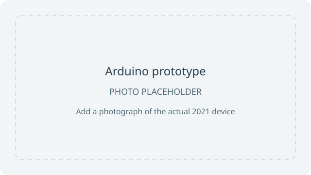
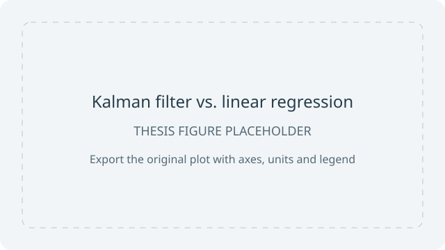

# Variometer-Maturarbeit

An Arduino-based paragliding variometer developed for my **Maturarbeit (Swiss
high-school thesis) in 2021**. It estimates altitude and vertical speed from sensor
measurements, provides acoustic feedback, and communicates over Bluetooth.

The project compares linear regression with a Kalman filter. It includes C++
classes for the variometer, linear regression, Bluetooth communication and packet
handling, FIFO buffers, C# simulation and analysis tools, and recorded sensor data.
The C# simulation uses simulated sensor noise; the Arduino simulation calculates
the velocity estimates. The Flutter companion app lives in the separate
[Variometer-FlutterApp repository](https://github.com/oiver12/Variometer-FlutterApp).

**Continuation:** I later continued the project in
[VariometerV2](https://github.com/oiver12/VariometerV2). This repository preserves
the 2021 thesis project.

## Repository guide

| Folder | Contents |
| --- | --- |
| `SaveSDCard/` | Arduino sketch for recording pressure changes and sample intervals to an SD card. |
| `VariometerVersion1/` | Arduino variometer using linear regression, moving averages, FIFO buffers and Bluetooth communication. |
| `VariometerVersion2/` | Arduino variometer using a Kalman filter, pressure and inertial sensors, acoustic feedback and Bluetooth/XCTrack communication. |
| `Variometer2Save/` | Arduino sketch that records pressure, acceleration, Kalman velocity estimates and orientation to an SD card. |
| `VariometerDataAnalysis/` | C# analysis of pressure recordings, with recorded experiments and Excel export. |
| `Variometer2DataAnalysis/` | C# analysis of Kalman-filter recordings, sensor-noise measurements and Excel export. |
| `TheorieExperimentC#/` | C# simulation with configurable sensor noise, saved velocity arrays and Excel export. Called “SimulationC#” in the original German text below. |
| `SimulationArduino/` | Arduino simulation using saved synthetic measurements to calculate Kalman-filter and linear-regression velocity estimates. |
| `VarioVortrag/` | Arduino demonstration sketch for the thesis presentation. |
| `docs/images/` | Image placeholders, a checklist and a plot of archived comparison arrays. |
| `scripts/` | Python script for plotting the archived comparison arrays without Excel. |

## Images and simulation

| Arduino prototype — photo pending | Thesis comparison plot — pending |
| --- | --- |
|  |  |

See the [image checklist](docs/images/CHECKLIST.txt) for the missing originals.
A separate [plot of the archived C# velocity arrays](docs/images/archived-comparison.svg)
can be regenerated on Linux:

```sh
python3 -m venv /tmp/variometer-plot
/tmp/variometer-plot/bin/python -m pip install -r scripts/requirements.txt
/tmp/variometer-plot/bin/python scripts/plot_comparison.py
```

The original C# projects target .NET Framework 4.6.1 and automate Microsoft Excel
through COM. They require Windows and Excel as written; they cannot run unchanged
with Linux `dotnet`. The Python script plots the saved velocity arrays over the
first 200 samples (7.96 seconds), matching the current C# loop and sampling
interval. It does not rerun the filters or regenerate noise. The repository does
not establish that the saved arrays, current noise settings and Arduino inputs
come from the same run. This plot is therefore an illustration of archived data,
not a verified reproduction of a thesis figure or a new performance result.

## Original German documentation

The original text below uses the names “Variometer1” and “Variometer2” for
`VariometerVersion1/` and `VariometerVersion2/` respectively.

Das Repository Variometer-Maturarbeit besteht aus verschiedenen Ordnern, welche einem Variometer oder einem Experiment zugeschrieben werden können. Der Programmcode ist kommentiert, wodurch der Programmcode verständlich sein sollte. In den folgenden Abschnitten wird daher nur auf den Aufbau der einzelnen Ordner eingegangen. Auch wird erwähnt, welche Klasse welche Funktion erfüllt.
## Ordner „SaveSDCard“
Mit diesem Arduino-Projekt lässt sich ein Flug ohne Geschwindigkeitsangabe auf die SD-Karte aufnehmen (siehe Abschnitt 4.5.1). Über die App „Bluetooth Terminal“ lässt sich der Bluetooth Adapter verbinden. Starten lässt sich die Aufnahme z.B. mit folgendem Befehl: „s100“. Wobei 100 die Starthöhe in Meter ist. Während der Aufnahme kann die Grösse der Datei, welcher auf dem Arduino abgespeichert wird, mit dem Befehl „f“ abgerufen werden. Mit dem Befehl „c“ muss die Aufnahme beendet werden. Das Beenden ist wichtig, da sonst die Datei auf der SD-Karte nicht gespeichert wird. Ca. alle 40 ms wird ein Zustand abgespeichert, welcher folgendermassen aufgebaut ist:
(Zeit seit letzter Messung in ms); (Druckdifferenz seit letzter Messung in Pascal)
Wobei die Wörter in Klammern in der Datei durch eine Zahl ersetzt werden (z.B. (Zeit seit letzter Messung in ms) wird ersetzt durch 40). Der Flug wird in der Datei „Data.txt“ abgespeichert. 
## Ordner „Variometer1“
In diesem Ordner ist der Programmcode für das Variometer mit der Linearen Regression gespeichert. Das Programm ist aus verschiedenen Dateien aufgebaut. Die Arduino Datei heisst „VariometerVersion1.ino“. Die Arduino Datei steuert das Variometer. Im Ordner sind auch folgende, selbstprogrammierten Klassen enthalten: Variometer, BluetoothCommunication, PacketHandler und LineareRegressio. Die Klasse „Variometer“ ist für das Ausrechnen der Höhe, den gleitenden Durchschnitt der Messungen und die Geschwindigkeitsangabe zuständig. Der gleitende Durchschnitt wird mit einem FiFo implementiert.  Die Lineare Regression wird von der Klasse „LineareRegression“ übernommen. Das Bluetooth Protokoll wird von der Klasse „BluetoothCommunication“ übernommen. Mit dieser Klasse können sowohl neue Pakete erstellt und verschickt werden als auch empfangene Pakete ausgewertet werden. Die Klasse PacketHandler ist eine Hilfsklasse für die Bluetooth Kommunikation. Die Klasse CRC stammt von RobTillaart und kann auf Github gefunden werden.
## Ordner „Variometer2“
In diesem Ordner ist der Programmcode für das Variometer mit dem Kalman Filter. Die Klassen „BluetoothCommunication“, „CRC“ und „PacketHandler“ wurden schon im Abschnitt 8.1.1.2 erwähnt. Die Arduino Datei ist die Datei „VariometerVersion2.ino“. In dieser Datei erfolgt das Ansteuern der Sensoren, das Piepen und das Ausrechnen des Kalman Filters. Auch wird in diesem Dokument die Kommunikation mit der App „XC-Track“ vollführt. 
## Ordner „Variometer2Save“
Dieses Arduino-Projekt wurde verwendet, um einen Flug mit der Geschwindigkeitsangabe des Kalman Filters abzuspeichern. Der Programmcode passt nur sehr knapp auf den Arduino Nanao Every (99% benutzter Flash Speicher). Das Speichern auf der SD-Karte startet unverzüglich nach dem Einschalten des Variometers. Das Piepen funktioniert auch bei der Aufnahme. Ca. alle 40 ms wird ein Zustand abgespeichert, welcher folgendermassen aufgebaut ist:
(Zeit seit letzter Messung in ms); (Druck in Pascal); (vertikale Beschleunigung in m/s^2 ); (Kalman Filter Geschwindigkeit in m/s); (Quaternion w); (Quaternion x); (Quaternion y); (Quaternion z)
Wobei die Wörter in den Klammern in der Datei durch eine Zahl ersetzt werden (z.B. (Zeit seit letzter Messung in ms) wird ersetzt durch 40). 
Die Datei wird all 10 Sekunden automatisch abgespeichert. Das „Variometer“ kann jedoch nicht über Bluetooth gesteuert werden.
## Ordner „VariometerDataAnalysis“
Dieses C#-Programm kann eine gespeicherte Datei aus Abschnitt 8.1.1.1. auswerten Auswerten bedeutet, dass aus den Zeitdifferenzen und Druckdifferenzen, die Zeit seit Beginn der Messung und der momentane Druck ausgerechnet wird. Aus dem Druck wird danach die Höhe bestimmt. Dass Programm kann, automatisch die Höhe und die Zeit in ein Excel Dokument eintragen. Im Programm können mehrere Textdateien gelichzeitig ausgewertet werden. Auch kann in Excel der Durchschnitt (aber nicht der gleitende Durchschnitt!) von x Messungen automatisch eingetragen werden.
## Ordner „Variometer2DataAnalysis“
Die Datei „Program.cs“ kann den aufgezeichneten Flug aus Abschnitt 8.1.1.4 auswerten. Auswerten bedeutet, dass aus den Zeitdifferenz die Zeit seit Beginn der Messung bestimmt wird und aus dem Druck die Höhe ausgerechnet wird. Danach kann die Zeit, die Höhe, die Geschwindigkeit des Kalman Filters und die Beschleunigung automatisch in eine Excel Datei eingetragen werden. 
Auch mit diesem Programm lässt sich die Standardabweichung der Höhe und der Beschleunigung bestimmen. Dafür werden z.B. 5 Minuten mit dem Programm „Variometer2Save“ (Abschnitt 8.1.1.4) auf einer SD-Karte aufgezeichnet. Im Programm kann der Durchschnitt der Standardabweichungen von mehreren Messungen (daher können mehreren Dateien ausgewertet werden) bestimmen werden. Mit diesem Programm lässt sich auch das Prozessrauschen bei einem Flug bestimmen. Dafür wird die Aufzeichnung eines Fluges benötigt. 
## Ordner „SimulationC#“
In dieser Datei werden die Daten für die Simulation in Abschnitt 5.3 berechnet. Die Standardabweichungen der Sensoren können eingestellt werden. Die Standardabweichung wird mit der „Box-Muller transform“ Methode zufällig durchgeführt. Die Zeit, die simulierte Höhe und die simulierte Beschleunigung werden auf der Konsole ausgegeben. Die Daten werden als Arrays ausgegeben, sodass die Daten direkt in das Arduino Projekt eingefügt werden können. Die berechneten Geschwindigkeiten des Arduino können im C#-Projekt auch direkt eingefügt werden. Alle Daten werden danach automatisch in einer Excel Datei abgespeichert.
## Ordner „SimulationArduino“
In der Datei „SimulationArduino.ino“ können die Zeit, die simuliert Höhe und die simulierte Beschleunigung aus der Ausgabe vom Programm SimulationC# hineinkopiert werden. Aus diesen Daten wird sowohl die Geschwindigkeit mit dem Kalman Filter als auch die Geschwindigkeit mit der Linearen Regression ausgerechnet. Die Aufgabe der Klassen Variometer und LineareRegression wurde schon in Abschnitt 8.1.1.2 erläutert. Die Klasse Variometer ist jedoch leicht abgeändert im Vergleich zu Abschnitt 8.1.1.2, sodass die Geschwindigkeit der Linearen Regression nach jeder neuen Messung ausgegeben wird (bei VariometerVersion1 wurde die Geschwindigkeit nur alle x Sekunden ausgegeben und nicht bei jeder neuen Messung).
Die Geschwindigkeiten werden als C# Arrays im Serial Monitor ausgegeben, sodass die Daten direkt in das C#-Programm eingefügt werden können. 
